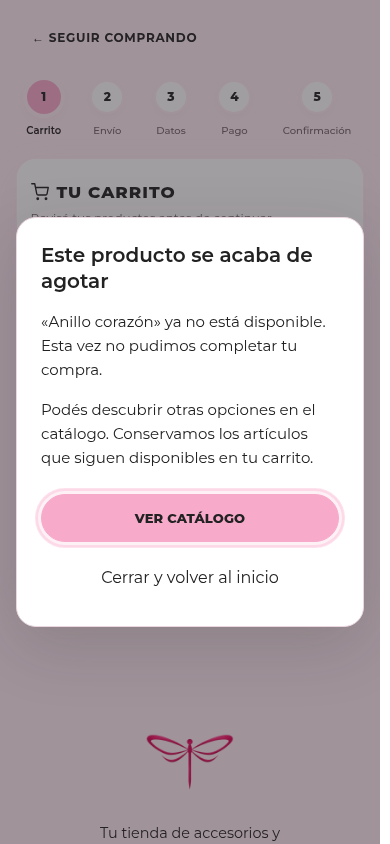
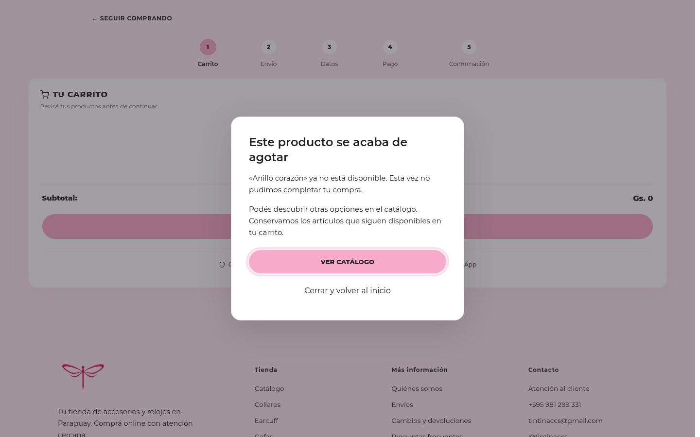
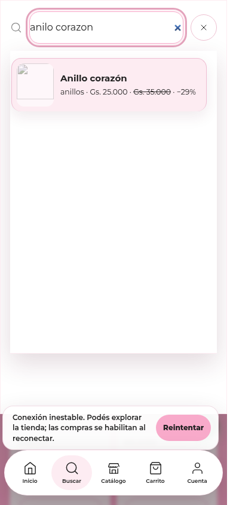

# Tintin · capturas de los cambios publicados

Capturas del formulario con datos de prueba y mapa simulado. Comparación de los archivos reales de iconos anterior y actual.

## Direcciones en escritorio

## Direcciones en móvil

## Iconos: antes y ahora

## Selector de color

## Revisión comercial — vista previa del candidato

Interfaz renderizada con datos de prueba. Estas capturas corresponden al candidato de revisión comercial; no certifican su publicación.

### Producto agotado en móvil

### Producto agotado en escritorio

### Búsqueda con una errata y precio anterior

