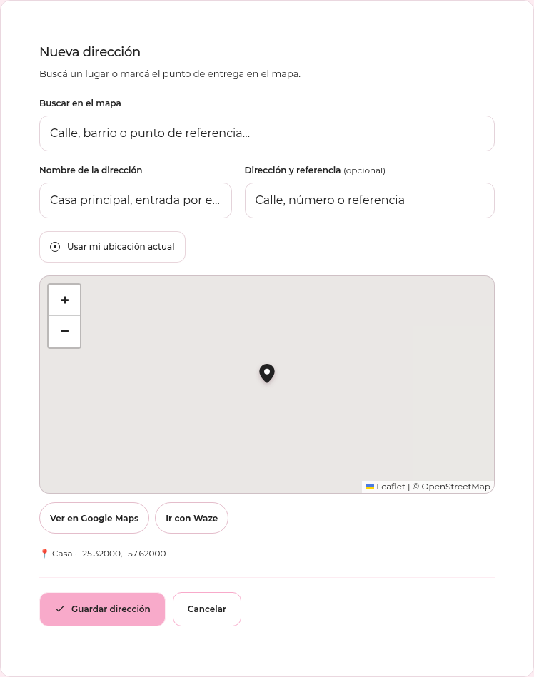
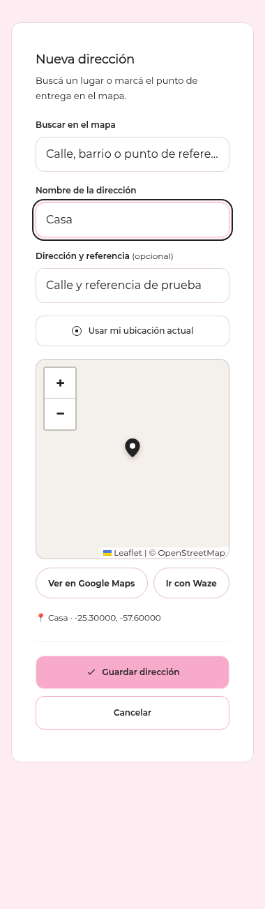
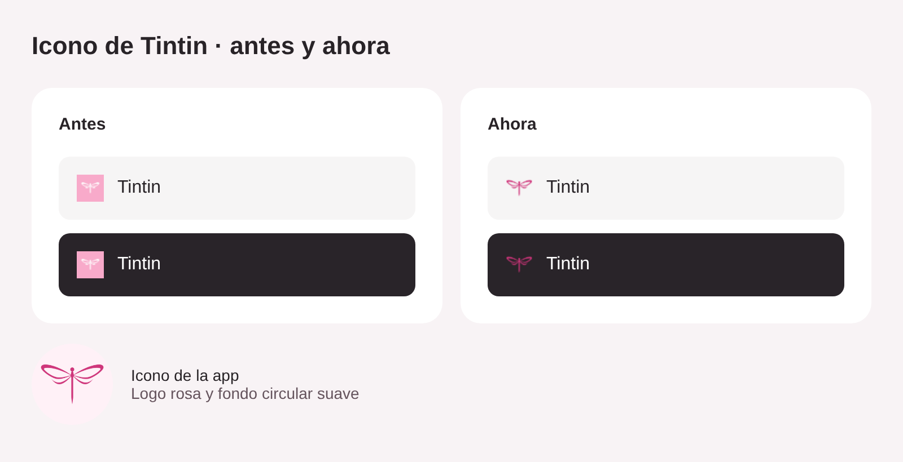
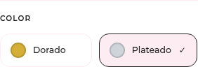

# Tintin · capturas de los cambios publicados

Capturas del formulario con datos de prueba y mapa simulado. Comparación de los archivos reales de iconos anterior y actual.

## Direcciones en escritorio

## Direcciones en móvil

## Iconos: antes y ahora

## Selector de color

