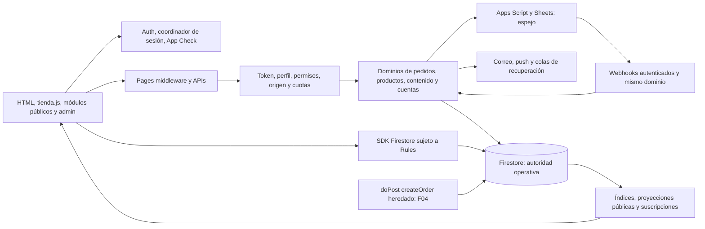

# Fase 01 — Auditoría global y arquitectura de Tintín

Fecha de trabajo: 2026-11-01 America/Asuncion (algunas evidencias tienen fecha UTC 2026-11-02).
Autor: Codex /root, GPT-6, Linux Cloud. Repositorio: tintinaccs/tintin-web.
Base auditada: **085953dc0b700e91f95fc8c84dd8e17f4627a70c**, árbol
b97e4feef9ee05718de9557da9c10f75351fe066. Los resultados siguientes pertenecen
a ese código, no certifican automáticamente un commit posterior.

**Resultado: diagnóstico completo con hallazgos abiertos; no aprobación global del comercio.**
Se demostraron dos hallazgos HIGH, tres MEDIUM y dos LOW. No se demostró un
CRITICAL; esto no prueba su ausencia. No se corrigió lógica funcional, no se
publicaron Rules ni se consultaron/modificaron registros reales de clientes.

## 1. Base, fase anterior y concurrencia

- main remoto y copia limpia coincidían en 085953dc al iniciar. #1307 está
  fusionada; CI 41361909966/intento 1, CodeQL 41361910183/1 y comprobación de
  producción 41361911653/1 tienen conclusión SUCCESS para ese SHA, consultada
  mediante API en esta sesión. No se transfirió el PASS desde otro head.
- Ruleset18212422 Protect main sigue activo (PR, squash, historial lineal, sin
  borrado/force-push); lectura del endpoint clásico de protección devuelve403.
  No se afirma haber leído esa configuración ni se modificaron requisitos.
- #1305 está fusionada en 7dfe8c9f; su CI final 41355599089/1 aprobó. El fallo
  post-merge 41357878092/1 era la deriva de protección corregida por #1307.
- #1306 permanecía abierta en 976601a99772e5390448b8da2edda79d9d6c1429:
  run 41358865966/1 FAILURE, anotación de pérdida de comunicación del runner
  125006122914; logs BlobNotFound/404. Además conserva el job de escritura
  retirado de main y un plan antiguo: no integrar sin conciliar #1307 y validar
  el nuevo SHA. Su rama y propuesta de auto-routing no se modificaron.
- La instalación en archivos está verificada: 45 Skills en cada ruta principal,
  cuatro de compatibilidad. El catálogo nativo del ejecutor volvió a devolver
  skills: []; no hay operación expuesta de registro/reindexación. Su activación
  sigue BLOCKED. Esta auditoría usa instrucciones leídas desde el repositorio.
- El antiguo TINTIN_GLOBAL_PHASES describía exclusivamente Skills/CI. Se conserva
  como [antecedente](TINTIN_SKILLS_CI_20261101.md); la numeración global actual
  sigue la solicitud de la titular: 01 es esta auditoría. El bloqueo del host no
  se convierte en PASS ni impide el diagnóstico no funcional solicitado.
- Se usó una rama separada y un worktree limpio del SHA base para build y
  navegador. No se sobrescribieron ni fusionaron ramas funcionales ajenas.

## 2. Inventario real

Fuente reproducible: [inventory.json](evidence/phase01-20261101/inventory.json),
construido por [collect-index.py](../../scripts/agent/phase01-audit/collect-index.py)
desde git y el manifiesto canónico del SHA auditado.

| Superficie | Inventario observado |
| --- | --- |
| Repositorio | 2.097 archivos versionados; js 329, cloudflare 50, functions 78, css 112, scripts 215, docs 259 |
| HTML raíz | 19 documentos: 18 superficies de aplicación/compatibilidad y una verificación de Search Console |
| APIs | 58 archivos functions/api/*.js; listado completo de rutas y referencias de seguridad en inventory.json |
| Código de ejecución indexado | 446 módulos, 961 aristas de import estático o dinámico literal; no incluye todos los enlaces indirectos por window/Workers/Apps Script |
| Diagnóstico canónico | 19 páginas, 1.146 módulos incluyendo herramientas/tests, 1.728 archivos; cero referencias locales faltantes detectadas en la base |
| Pruebas | 500 archivos bajo tests, incluidos helpers/fixtures; no equivalen a 500 casos ni a cobertura exhaustiva |
| Publicación | Cloudflare Pages + Pages Functions; Firebase Auth/Firestore; sin Firebase Hosting/Functions activos en firebase.json |
| Dependencias | Herramientas npm de desarrollo; Firebase web del navegador carga CDN 10.14.1. No confundirlo con firebase 13.x usado en herramientas/tests |

### Páginas y rutas

| Documento / ruta | Función y autoridad principal |
| --- | --- |
| index.html / | Inicio, selección/index de productos, bloques y recomendaciones; estado-productos e indice-inicio |
| catalogo.html /catalogo | Catálogo, categorías, filtros, variantes y compra; política de exhibición/visibilidad compartida |
| collections.html /collections | Colecciones y acceso a catálogo; colecciones públicas y agrupación Pulseras |
| product.html /product?id=… | Ficha, selección comercial, stock y relacionados; Pages renderer + módulo de producto + suscripción del documento |
| functions/products/[handle].js /products/:handle | Compatibilidad/SEO de producto por handle; no otra base de productos |
| functions/collections/[handle].js /collections/:handle | Alias de colección, no una autoridad comercial adicional |
| checkout.html /checkout | Sesión/perfil, entrega, cotización, pago y pedido; política cliente y dominio servidor |
| login.html /login | Google/OTP, disponibilidad y alta; Firebase Auth + reservas canónicas |
| perfil.html /perfil | Perfil, ubicaciones e historial; índice privado paginado y documentos de pedido |
| admin.html /admin | Usuarios, productos, pedidos, contenido, estadísticas, permisos, integraciones y operación |
| admin-images.html /admin-images | Administración de medios; misma identidad y backend privado |
| about.html /about | Información de marca; contenido y shell público |
| nosotros.html /nosotros | Compatibilidad/redirección a about, no módulo comercial duplicado |
| contact.html /contact | Contacto y configuración pública |
| envios.html /envios | Información de entrega |
| cambios-devoluciones.html /cambios-devoluciones | Políticas comerciales |
| preguntas-frecuentes.html /preguntas-frecuentes | Ayuda |
| terminos.html /terminos; privacidad.html /privacidad | Contenido legal |
| 404.html /404 | Error navegable y shell público |
| googlef396be0b943aa3d1.html | Verificación de Search Console; no página funcional ni objetivo responsive |
| functions/pages/[slug].js; policies/[slug].js | Contenido/compatibilidad por slug, sujeto a sanitización y rutas existentes |

_routes.json tiene 100 reglas include/exclude en total: está en el límite vigente,
no por encima. Se genera desde scripts/lib/rutas-pages.js. Una nueva API/documento
requiere revisar el presupuesto sin sustituirlo por comodines amplios.

## 3. Arquitectura y autoridades de datos

La presentación combina HTML estático, JS clásico y módulos ES; no es una SPA
con un único bundle. tienda.js coordina UI pública y adaptadores; js/core y
js/pages contienen políticas/componentes compartidos. El navegador es no confiable.
Cloudflare verifica identidad/permisos y ejecuta operaciones privilegiadas por REST
con precondiciones. Auth identifica; Firestore persiste y Rules protegen el SDK.
Apps Script/Sheets actúan como espejo y superficie operativa, con la excepción
heredada demostrada en F04.

| Dato | Origen y modificación | Persistencia / consistencia | Consumo y derivados |
| --- | --- | --- | --- |
| Identidad y roles | Firebase Auth; contrato config/account-contract.json; roles/permisos leídos del perfil protegido | users/{uid}, customerId CUS_uid; phoneReservations y usernameReservations; contrato generado para browser/Cloudflare/Apps Script | coordinador-sesion, roles, cliente-api-autenticado; Rules y guards server-side |
| Producto, precio y stock vendible | Editor administrativo/importación o webhook de Sheets; product-editor-domain y dominio de pedidos | products; precio, stock agregado y variantInventory. Escrituras CAS/updateTime; reserva/liberación junto al pedido | public-catalog, estado-productos, políticas de catálogo, ficha, carrito y cotización. Snapshot del pedido no se reconstruye del catálogo |
| Datos privados de inventario | Editor autorizado: costUnit, purchased, stockMinimum, internalNotes | productInventory, con precondición propia dentro del commit del editor | Admin; excluido de la lista blanca de public-catalog |
| Colecciones y merchandising | Admin y configuración pública; normalización/agrupación compartida | collections y campos de actividad/orden de products | Inicio, menús, catálogo, relacionados y URLs; stock cero visible pero no comprable |
| Carrito | Intención de compra; línea estable producto/variante; compatibilidad tt_cart | Invitado local con TTL; usuario users/{uid}/cart/{lineId}; cola serializada y control de generación de sesión | Cuenta, drawer, checkout. Los precios almacenados no autorizan el cobro |
| Entrega y cupón | Selección del cliente; servidor relee tarifas y valida vigencia/límites | settings/general, settings/shippingRates, coupons y couponRedemptions; contador con CAS | Cotización esperada comparada con la canónica; descuento y datos históricos en el pedido |
| Pedido e inventario | createOrderViaServer → integration-router → apps-script-bridge → preparePublicCheckoutOrder → createOrderAdmin | orders/{uid_requestId}, settings/orderSequence, productos, auditoría y notificación en commit atómico; reserva al checkout, idempotencia por ID | Perfil, Admin, correo, push, estadísticas, Sheets y pagos |
| Operación administrativa de pedido | Superadmin/Sheets invocan admin-order-mutation / applyOrderAdminMutation | Revisión optimista lastChangeId/baseChangeId, ciclo canónico, stock y auditoría | Vistas en vivo, notificaciones, correo de cambio y espejo. Permanece un acceso SDK de staff defectuoso: F01 |
| Resumen de cliente | Hooks posteriores a creación/cambio/archivo llaman syncOrderOwnerStats | Campos derivados de users y orderStats; actualmente scan global limitado y MERGE sin revisión: F02 | Perfiles/estadísticas y señales de recálculo; orders sigue siendo la fuente primaria |
| Pago | Configuración/quote server-side; PayPal sólo si está habilitado y configurado | Estado de pago y referencias históricas; captura/webhook validado en backend | Checkout, pedido y operador; navegador no autoriza pago. No se efectuaron pagos sandbox/live en esta auditoría |
| Correo y push | Pedido confirmado o cambio administrativo, con claves estables y permisos propios | emailLogs, orderEmailQueue, pushEvents, adminPushDevices; reclamos, backoff y límites de reintento | Resend/FCM y UI de diagnóstico. No son parte de la transacción de stock |
| Sheets | Edición de celda/operación identificada, webhooks y reconciliadores | products/orders/users en Firestore; catálogo/colas y syncMeta como acuse; hoja conserva versiones/cambios pendientes | Productos, Pedidos web, Usuarios web, historia local y espejo de auditoría; no otra fuente de verdad |
| Comercio local | Casillas mensuales y panel; dominio comercio-local | localCommerceEntries, salesCustomers y proyección orders; separado de inventario y altas Auth | Estadísticas, meses y clientes de ventas; no asimilar a checkout ni migrar por coincidencia de nombre |
| Contenido y apariencia | Editor, publicación y configuración autorizados | site_content, settings, colorSchemes, visualBuilder* y visualStudio* | Renderers con sanitización, documentos y tokens; borradores no equivalen a publicación |
| Versionado | Cambios de fuente → generadores de rutas/CSP/diagnóstico/caché | diagnostic-manifest.json y site-version.json, URLs inmutables y huellas semánticas | Middleware, CSP, monitor de artefacto y aviso de versión. CRUD comercial no debe forzar recarga |

### Dependencias y estado compartido

- Fan-in directo observado: firebase.js 78 consumidores; firebase-admin-ligero 58;
  seguridad-cloudinary 52; coordinador-sesion 48; roles 30; inventario-variantes 25.
  Sus cambios requieren revisar todos los consumidores, no sólo la página editada.
- El grafo tiene un componente circular de tres módulos: correo-estado-pedido,
  resiliencia-correo-pedido y functions/api/order-email. Sus funciones se usan
  después de evaluar módulos; no se reprodujo fallo de carga/TDZ. Es riesgo de
  acoplamiento, no motivo suficiente para refactorizar ni un fallo contado.
- No se detectaron scripts[src] repetidos ni IDs duplicados en los 19 documentos
  del manifiesto. Esto no prueba que no existan efectos duplicados dinámicos.
- CartSync usa singleton __TintinCartSyncV2; el cargador de secciones Admin comparte
  la promesa pendiente y vuelve a comprobar permisos tras descargar. Los listeners
  de settings se detienen al reiniciar. startAdminSettingsRealtimeLegacy contiene
  código comentado y no tiene llamadas: no se cuenta como una segunda ejecución.
- No hubo grupos de módulos de ejecución idénticos byte a byte en el índice.
  La duplicación semántica importante sí existe en el creador Apps Script: F04.
- La lista de candidatos de indexación no autoriza declarar código muerto: hay
  registros window, imports indirectos, Workers, scripts clásicos y globals .gs.

## 4. Hallazgos priorizados

Todos permanecen abiertos salvo la reorganización del seguimiento solicitada.
Los probes con salida 0 confirman la reproducción de una anomalía; no convierten
el invariante de negocio en PASS.

### F01-RULES — HIGH — Escritura de inventario de pedido sin permiso de módulo

- Ubicación: [firestore.rules:1491](../../firestore.rules#L1491), allow update de
  orders; [staffOrderInventoryTransitionValid:920](../../firestore.rules#L920).
- Evidencia: agent con pedidos.ver/cambiarEstado/cambiarPago/reenviarCorreo=false
  no pudo leer el pedido, pero updateDoc de inventoryState=released e
  inventoryRevision=999 fue aceptado. El stock permaneció 0. Anónimo y cliente
  fueron rechazados. Se usaron Rules reales y sólo demo-tintin-phase01 en loopback.
- Causa: inventory* está en hasOnly; el permiso se exige para status/payment/aviso,
  no para inventario. El helper retorna true si status no cambia y omite entonces
  coherencia/revisión. No atraviesa el dominio de pedidos ni sus efectos de auditoría.
- Impacto: un miembro staff sin permiso de pedidos puede corromper reservas y
  revisiones; operaciones posteriores pueden interpretar una reserva incorrecta.
  No se demostró explotación sobre reglas desplegadas ni modificación real.
- Solución mínima: cerrar la escritura SDK sensible para staff o exigir un camino
  coherente completo y autorizado, conservando el endpoint canónico. Revisar antes
  los consumidores legado y la excepción explícita Superadmin. No basta ocultar UI.
- Evidencia ejecutable: [rules-probe.mjs](../../scripts/agent/phase01-audit/rules-probe.mjs),
  [resultado](evidence/phase01-20261101/rules-result.json). Prioridad: fase 02.

### F04-LEGACY — HIGH — Segundo creador de pedidos con lógica de variantes incompatible

- Ubicación: [doPost:1096](../../apps-script/ProductosUnificados.gs#L1096) enruta
  createOrder a [phase4CreateOrder_:424](../../apps-script/CrearPedido.gs#L424).
  La creación canónica actual vive en apps-script-bridge:259–323 y order-admin-domain.
- Evidencia: producto V1 válido con stock agregado 2, Dorado=0 y Plateado=2.
  El dispatcher Apps Script creó el pedido Dorado y escribió stock agregado 1,
  sin actualizar variantInventory. createOrderAdmin rechazó exactamente esa
  variante: «Stock insuficiente para la variante Dorado. Disponible: 0.»
- Causa: Apps Script valida opciones y stock agregado, pero no la matriz de stock;
  mantiene su propia transacción, secuencia y efectos. Sólo acepta V1; V2 sigue
  otro comportamiento. El router del navegador no elimina un endpoint servidor.
- Impacto: si este código está instalado como Web App accesible, permite una compra
  incompatible con la disponibilidad canónica. **La versión desplegada de Apps
  Script y sus callers externos no fueron verificados**; no afirmar explotación
  ni que el checkout normal actual siga pasando por esa rama.
- Solución mínima: comprobar deployment/callers y retirar o delegar la acción
  heredada al dominio único; preservar espejo y compatibilidad autorizada. Cubrir
  V1/V2, cero stock de variante, reintento, secuencia y efectos posteriores.
- Evidencia: [legacy-order-probe.mjs](../../scripts/agent/phase01-audit/legacy-order-probe.mjs)
  y [resultado](evidence/phase01-20261101/legacy-order-result.json), con I/O sintético.
  Prioridad: 02 para autoridad/exposición; 03 para regresión comercial.

### F02-STATS — MEDIUM — Resumen derivado incompleto y susceptible a sobrescritura atrasada

- Ubicación: [syncOrderOwnerStats:60](../../cloudflare/sincronizacion-estadisticas-pedido.js#L60)
  y [firestoreAdminListAll:657](../../cloudflare/firebase-admin-ligero.js#L657).
  Lo llaman bridge, admin-order-mutation, sheets-admin-webhook y commerce-controls.
- Evidencia de volumen: se solicitan como máximo 5.000 pedidos globales, se filtra
  por dueña después y no se pide failOnTruncation. Con 5.000 pedidos ajenos y uno
  propio fuera del recorte se persisten totalOrders=0 y totalSpent=0.
- Evidencia de carrera: un snapshot reciente escribió totalSpent=30 y un cálculo
  anterior que terminó tarde escribió 10 después. No hay CAS/revisión del resumen.
- Impacto: estadísticas persistidas incorrectas y trabajo O(pedidos globales) por
  evento. Los documentos orders no se pierden. No se verificó el volumen real de
  producción ni qué clientas podrían estar afectadas.
- Solución mínima: consultar/agregar por identidad, conservar el puente histórico
  por email y deduplicar por ID; no publicar un resultado truncado como completo.
  Proteger la publicación con revisión/snapshot o proyección serializada. Subir el
  límite global no corrige ni la carrera ni el costo.
- Evidencia: [stats-probe.mjs](../../scripts/agent/phase01-audit/stats-probe.mjs) y
  [resultado](evidence/phase01-20261101/stats-result.json). Prioridad: fase 04.

### F03-FALLBACK — MEDIUM — El artefacto del fallback manual tiene recursos faltantes

- Ubicación: [scripts/preparar-hosting.js:8](../../scripts/preparar-hosting.js#L8),
  listas de copia; consumidor .github/workflows/desplegar-pages.yml.
- Evidencia: build:pages y prepare:hosting terminaron 0 en worktree limpio, pero
  public/index.html referencia /styles.min.css, /tienda.js y dos favicons que no
  existen en el artefacto. También faltan site-version.json, el SW de push y vendor.
- Impacto: el fallback manual puede publicarse con estilo y JS central ausentes.
  **No es un fallo demostrado del despliegue canónico de Cloudflare.** GitHub Pages
  tampoco ejecuta Pages Functions, lo que debe formar parte del contrato fallback.
- Solución mínima: construir/cerrar las referencias del paquete desde los recursos
  canónicos y probar el contenido publicado; definir explícitamente el modo de
  API/funciones o degradación de respaldo. No copiar indiscriminadamente el repo.
- Evidencia: [fallback-probe.mjs](../../scripts/agent/phase01-audit/fallback-probe.mjs),
  [resultado](evidence/phase01-20261101/fallback-result.json). Prioridad: fase 08.

### F05-DEPS — MEDIUM — Avisos moderados en herramientas npm

- Ubicación: package-lock.json:4545 (glob 10.5.0), 4596 (minimatch 9.0.9 anidado),
  otras copias de minimatch; firebase-tools y su cadena transitiva.
- Evidencia actual: npm audit --package-lock-only --json devolvió 14 paquetes
  afectados por dos avisos únicos: GHSA-3g3m-2fjr-6pw4 (cancelación de glob y
  recorrido tras timeout) y GHSA-g3hv-75wg-m249 (amplificación de globparts).
  Cero HIGH/CRITICAL en esa consulta npm, no una certificación de la aplicación.
- Impacto: riesgo DoS/consumo de recursos en herramientas que procesen patrones o
  árboles no confiables. Son dependencias de desarrollo; no se demostró exposición
  del storefront, de Firebase CDN ni del runtime REST de Cloudflare por esos avisos.
- Solución mínima: evaluar versiones transitivas corregidas compatibles con CLI,
  engines y lock; repetir build y emuladores. No aplicar npm audit fix --force:
  el fix sugerido incluye un downgrade mayor de firebase-tools a 13.11.2.
- Evidencia: [npm-audit-summary.json](evidence/phase01-20261101/npm-audit-summary.json).
  Prioridad: fase 08; no introducir dependencias nuevas por preferencia.

### F06-CONTRACTS — LOW — Contratos/comentarios atribuyen el checkout a una autoridad anterior

- scripts/auditar-integraciones-canonicas.mjs:69 y apps-script-bridge.js:26/232
  aún dicen que Apps Script ejecuta la creación privilegiada; el branch createOrder
  retorna desde createOrderAdmin antes de llegar al fetch de upstream.
- docs/arquitectura-tecnica.md presenta functions como adaptadores opcionales,
  mientras firebase.json, _routes y los handlers muestran Pages Functions como
  backend operativo. El bloque posterior action=createOrder de bridge:335 es
  inalcanzable después del return del branch actual.
- Impacto: otro agente puede reparar/migrar el lugar equivocado o reactivar el
  dominio duplicado. Las autoridades se deciden por código/configuración vigentes.
- Solución mínima: alinear documentación/comentarios y retirar el branch muerto
  después de comprobar sus consumidores; no reconstruir el checkout. El conflicto
  de numeración del seguimiento se resuelve documentalmente en esta fase.
- Prioridad: 01 para mapa correcto; remanentes de fuente/contrato en 08.

### F07-INDEX — LOW — Dos colecciones fantasma en el índice diagnóstico

- Ubicación: scripts/construir-manifiesto-diagnostico.js:506; lee literales que
  parecen collection(db,…) dentro de scripts/auditar-admin-analitica-auditar.js:266/272.
- Evidencia: collectionsUsed y usedWithoutExplicitRule contienen dos nombres con
  fragmentos de código y salto de línea. No son colecciones ni dos Rules faltantes.
- Impacto: inventario/indicadores de análisis incorrectos. analyzeDataReadonly en
  diagnostico-sitio-admin.js:1067 filtra los nombres con regex: no se demostró una
  consulta inválida por esos nombres ni exposición de datos.
- Solución mínima: corregir el extractor canónico para distinguir código/literales
  y restringir el alcance de inventario; añadir regresión y regenerar. Nunca editar
  diagnostic-manifest.json a mano.
- Evidencia: [diagnostic-index-result.json](evidence/phase01-20261101/diagnostic-index-result.json).
  Prioridad: fase 08.

## 5. CORRECT y NOT APPLICABLE

| Clasificación | Evidencia y límite |
| --- | --- |
| CORRECT | Checkout canónico relee productos/precios, valida variante, cotización y entrega; commit de pedido, secuencia, inventario, auditoría y notificación con precondiciones. Pruebas de dominios aprobadas; no equivale a compra real en producción |
| CORRECT | Cambios administrativos normales convergen en applyOrderAdminMutation, con changeId/baseChangeId; Sheets es espejo y no participa del commit comercial |
| CORRECT | Datos privados de inventario no están en la proyección pública; sesión y permisos no dependen de ocultar botones. F01 es una excepción de escritura concreta, no ausencia total de seguridad |
| CORRECT | Rutas, CSP, contratos de cuentas y caché tienen constructores/gates existentes; build limpio reproducible; no se creó un generador de publicación alternativo |
| CORRECT | Singleton del carrito, promesas de carga por sección y controles de generación de sesión reducen duplicados; no se afirmó ausencia universal de carreras |
| CORRECT | Los correos/push y los espejos se ejecutan después del commit y cuentan con colas/reclamos/backoff existentes. El ciclo de imports de correo es un riesgo, no un fallo reproducido |
| CORRECT | 12 workflows vigentes; sólo auditar-tintin valida PR a main. CodeQL dinámico y notificaciones de cierre no son una segunda suite canónica |
| NOT APPLICABLE | La eliminación de cuentas está diferida por contrato; no se declara CRUD faltante ni se reactiva un lifecycle no solicitado |
| NOT APPLICABLE | No se exige SQL/Data Connect, Firebase Hosting/App Hosting ni Functions: el runtime actual usa Firestore y Cloudflare Pages Functions |
| NOT APPLICABLE | Stock null ilimitado no es dato faltante. Stock 0 visible/agotado no significa que deba ocultarse |
| NOT APPLICABLE | Alias nosotros/products/collections y compatibilidad V1/V2 no se eliminan sólo por parecer duplicados |
| NOT VERIFIED | Configuración remota de índices, Rules realmente desplegadas, versión/triggers instalados en Apps Script y credenciales/permisos del proveedor. Ausencia de firestore.indexes.json no prueba que falten índices en producción |
| NOT VERIFIED | Pago real/sandbox, entrega en dispositivo físico, envío real de email/push y sesiones administrativas productivas. No se realizaron escrituras comerciales para probarlos |

## 6. Pruebas ejecutadas y huecos concretos

[validation.json](evidence/phase01-20261101/validation.json) registra los resultados.
Los conteos se solapan; no sumarlos como cobertura única.

| Verificación sobre la base | Resultado |
| --- | --- |
| Ocho gates: arquitectura, 38 pruebas de gates, estructura, integración canónica, módulos, cuentas, sincronización y caché | Todos salida 0 |
| Checkout, pedidos, pagos, carrito, cuentas y sync: tests existentes seleccionados | 642 PASS; 0 FAIL/skipped |
| Regresiones de CI inmutable y exclusiones de diagnóstico | 3 PASS |
| build:pages en worktree limpio de 085953dc | PASS; git diff sin deriva antes de preparar fallback |
| prepare:hosting | Comando salida 0; integridad del artefacto FAIL en F03 |
| Smoke existente de páginas | 18 rutas PASS; Producto es documento base, no una compra ni renderer productivo completo |
| Geometría canónica existente | 144/144, 18 superficies en 8 viewports; Admin usa fixture de geometría aislada |
| Helper global de accesibilidad | 5/5 PASS con DOM sintético; no certificación WCAG global |
| Probes adversariales de esta fase | F01, F02, F03, F04 reproducidos. Su salida 0 significa anomalía confirmada |
| npm audit de lock | FAIL por moderados; 14 paquetes, 2 avisos únicos; sin fix aplicado |
| Archivos Skills | 45 por ruta válidos; activación nativa BLOCKED |

Runtime local: Node 24.19.0, Java 21 y Chromium del sistema 151.0.7922.173.
El primer intento de smoke no inició por falta del Chromium empaquetado en caché.
Se usó el ejecutable existente /usr/bin/chromium mediante adaptador de launch-path,
sin cambiar fixtures, aserciones ni plazos. CI de la base usa Node 22 y su navegador
bloqueado por el lock. No se añadieron dependencias npm ni se instaló en Windows.

Cobertura faltante que debe convertirse en regresión antes de corregir:

1. Agent/admin sin permiso de pedidos intentando cada inventory*, revisión y
   combinación de status/payment, más cancelación de pedidos de 5–60 líneas.
2. Paridad de todas las entradas servidor para V1/V2, variante agotada y
   variantes retiradas; comprobación del Web App real antes de cerrar F04.
3. Resumen de cuenta con más de 5.000 pedidos globales y callbacks fuera de orden;
   identidad histórica por email, cancelados, archivados y pedidos de prueba.
4. Cierre de referencias del paquete public, incluidos JS/CSS/SW/vendor, y contrato
   de APIs/origen del fallback manual. Un build exitoso no prueba ese cierre.
5. Frescura de catálogo abierto tras reserva de otro cliente y tras revisión
   administrativa que llega antes de vencer la caché edge. El listado no usa un
   listener Firestore completo; TTL no es por sí mismo un mecanismo de refresh.
   Es un riesgo a verificar, no un fallo adicional declarado sin reproducción.
6. Versiones y triggers remotos de Apps Script, índices y Rules desplegadas;
   límites reales de colas y sandbox de proveedores con acceso autorizado.
7. Accesibilidad con contenido real, teclado/lectores de pantalla y roles,
   responsive con tablas/formularios poblados y latencia/error; Safari/WebKit y
   hardware. Campo CWV/INP, presupuesto con catálogo grande y red limitada.
8. Extractor diagnóstico ante literales de auditoría y símbolos indirectos;
   tests de arquitectura semánticos para los caminos que los gates regex no ven.

## 7. Riesgos de regresión y fases siguientes

| Cambio futuro | Riesgo y condición de conservación |
| --- | --- |
| Cerrar la escritura SDK de pedidos | Revisar consumidores directos y excepción Superadmin antes de quitar permisos. UI y Sheets deben seguir usando el dominio existente; no cambiar datos históricos |
| Retirar creación Apps Script | Inventariar deployment/callers/triggers y compatibilidad antes de publicar. No retirar espejo ni ejecutar rollback/migraciones reales durante la auditoría |
| Corregir estadísticas | Conservar UID/email histórico y deduplicación; no mover el problema a scans mayores ni permitir que un snapshot viejo pise el nuevo |
| Optimizar módulos compartidos | Fan-in 78/58/52/48; cubrir consumidores por rol/ruta, draft/sesión, URLs y efectos. No extraer un nuevo framework para resolver un defecto puntual |
| Tocar CSS/shell | Mantener tokens/identidad y revisar cascada y anchos limítrofes; 144 casos de geometría no sustituyen revisión visual ni WCAG manual |
| Corregir fallback/dependencias | No copiar herramientas/secretos al artefacto; no downgrade forzado del CLI; mantener Routes/CSP, 12 workflows y controles protegidos |
| Actualizar el seguimiento | Registrar SHA/PR/run/intento reales. El PASS de esta base y los probes que confirman un fallo no certifican la futura reparación |

| Fase | Alcance y prioridad | Depende de | Criterio de salida |
| --- | --- | --- | --- |
| 00 | Base/Skills/CI | — | Código/CI de base confirmados; activación nativa se mantiene BLOCKED hasta prueba del host |
| 01 | Este diagnóstico y mapa | 00, con excepción explícita para análisis no funcional | Informe, inventario, reproducciones, cobertura y pendientes disponibles |
| 02 | Seguridad, permisos y autoridad de escritura | 01 | F01 cerrado por regresiones negativas/positivas; F04 exposición/delegación resuelta o descartada con evidencia remota |
| 03 | Integridad comercial: catálogo/variantes, precio, stock, carrito, checkout, pedidos/pagos | 02 | Misma autoridad por todas las entradas; atomicidad/idempotencia y V1/V2 verificadas |
| 04 | Persistencia, proyecciones, índices, sincronización y caché | 02/03 | F02 cerrado; frescura y recuperación verificadas; índices según consultas reales |
| 05 | Administración, notificaciones, correo y procesamiento | 03/04 | Permisos y side effects consistentes, retries y operación parcial probados sin duplicados |
| 06 | UI pública/admin, rutas, módulos, estilos y estado | 03/04 | Datos/acciones coherentes con los dominios; navegación/estados por rol y dispositivo |
| 07 | A11y, rendimiento y SEO medidos | 05/06 | Matriz automática más límites/manuales explícitos; no sólo apariencia ni fixtures |
| 08 | Build, publicación, CI, dependencias y mantenimiento | 01/02; puede preparar trabajo paralelo a 03–07 | F03/F05/F06/F07; preservación de gates, artefacto reproducible y fallback completo o delimitado |
| 09 | Aceptación global y entrega | 02–08 + límites de 00 | Sin HIGH abiertos, pruebas aplicables terminales, limitaciones externas con responsable y siguiente acción |

## 8. Handoff exacto

1. Leer AGENTS.md, docs/agent/README.md, este informe y TINTIN_GLOBAL_PHASES.
2. Consultar main/PR abiertas de nuevo. Este informe analiza 085953dc, no su
   propio commit documental ni el head futuro de #1306. Revisar sólo el diff
   posterior para determinar si cerró un hallazgo antes de reproducirlo.
3. Empezar fase 02 por F01. El probe reproduce el defecto; al corregir, convertir
   el caso en una regresión que exija rechazo, más operaciones válidas del dominio.
4. Continuar con la autoridad Apps Script F04. La verificación del deployment es
   un pendiente externo concreto; no inferir que el .gs versionado está instalado.
5. Aplicar cambios mínimos sólo cuando se solicite esa fase de reparación. Rules,
   datos reales, pasarelas y publicación de Web Apps no se cambian por este informe.
6. Reutilizar contratos, generadores y pruebas. No ejecutar probes de escritura
   contra un proyecto real. No editar derivados para silenciar un gate.
7. Guardar nuevos recibos por SHA; no reemplazar la evidencia fija de esta carpeta
   ni heredar un PASS histórico a una reparación nueva.

Comandos de reproducción y límites en
[evidence/phase01-20261101/README.md](evidence/phase01-20261101/README.md).
