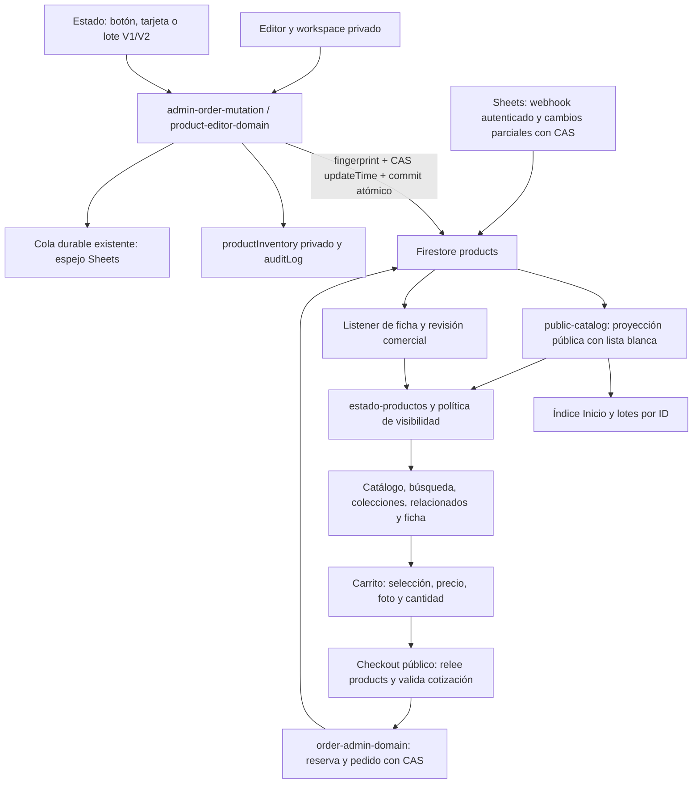

# Fase 04 — Catálogo comercial (2026-11-02)

Responsable: Codex /root. Base conciliada: e3de73c14c8113244f7456db123f10d1730eaaa0 (#1310). Evidencia de esta ejecución,
no aprobación heredada. Estado: PASS_LOCAL de dominio/build y31recorridos Chromium sobre la base
conciliada; cierre integral IN_PROGRESS hasta CI y dependencias abiertas. No hubo escrituras de
inventario, pedidos, usuarios, pagos, correos ni migraciones en producción.

Se sigue TINTIN_GLOBAL_PHASES.md y el informe PHASE03_ADMIN_PRODUCT_EDITOR.
El checkout inicial d7faa302 estaba atrasado: después de consultar el conector
GitHub se actualizó origin/main y se concilió sobre e3de73c1, preservando02/03,
la app móvil administrativa y sus recursos. El barrido largo sobre la base vieja
se interrumpió deliberadamente: no acredita el candidato conciliado.

La instrucción actual define04 como reparación del catálogo comercial. El plan
anterior también asignaba a04 F02-STATS (resumen de cuentas/pedidos): permanece
pendiente fuera del catálogo. HIGH F01-RULES y F04-LEGACY de01 siguen abiertos
como dependencias03A/03B; no se certifica cierre global ni se modifica sin
validar callers el deployment legado de Apps Script. Éste puede reservar stock
agregado ignorando la matriz de variantes, según la reproducción de01. El
checkout web canónico sigue siendo Cloudflare/order-admin-domain, que sí
valida la combinación y su stock. No se probó el deployment legado real.

## Recorrido de datos

`products` es la fuente comercial. `productInventory` contiene datos privados;
Sheets es una superficie operativa/espejo, no autoridad de la tienda.
No se agrega otro sincronizador ni se habilita V2 automáticamente.
Los controles de stock V1 siguen su transacción existente; la publicación
ahora converge en el escritor de servidor tanto en V1 como en V2.

## Hallazgos corregidos

| Severidad | Evidencia y causa | Corrección |
| --- | --- | --- |
| HIGH | `saveProductBulk` permitía activar borradores sin descripción/portada o con datos inválidos; botón legacy escribía sólo `active`, dejando `publicationStatus` incoherente y sin comparar la revisión. | Botón, tarjeta y lote de estado pasan al endpoint existente; fingerprint, CAS, estado editorial, validación completa y colección existente antes del commit del lote. Una publicación individual conserva su permiso propio; lotes requieren accionesMasivas. Se respeta ver:false. |
| HIGH | Checkout aceptaba precio legacy cero/null/decimal al convertirlo a Number y redondear, incluso con cotización manipulada coincidente. Regresión falla antes del cambio. | `inspect` usa `productVariantPrice`, compartido con el motor comercial: entero positivo acotado, incluidos overrides V2. Ningún pedido/reserva se escribe al rechazarlo. |
| MEDIUM | El escritor limpiaba únicamente el alias image. `mapProduct`, metadata e índice Inicio aún consultan img/photo/imageSrc/image_src y aliases de importación; metadata también consulta images. | Al editar portada/galería se actualizan sólo los aliases ya existentes en el mismo patch atómico; una eliminación no revive fotos anteriores. No se crean campos legacy nuevos. |

## Cobertura y escenarios

| Área | Evidencia local y comportamiento |
| --- | --- |
| Alta, edición, publicar/despublicar, archivo | editor-comercial/editor-editorial/product-workspaces, product-toggle-result y controlador real. Alta con exists:false; cambios con fingerprint/updateTime; reintento del changeId ganador idempotente. Archivo se conserva al desactivar; activación explícita cambia a active. |
| Categorías, colecciones, filtros, etiquetas, búsqueda | suites catalog/sync/admin: categorías normalizadas, aliases Pulseras, búsqueda compartida, paginación y selección. Publicar exige colección existente; mover categoría valida destino. |
| Orden y paginación | catalogo-paginado, commerce-products-paged, admin-page-size-and-selection-contract, home-index-api y home-request-order: límites, cursores, deduplicación, descarte de respuesta vieja y rechazo de truncamiento. |
| Imágenes | color-photos, variant-image, product-stock-metadata, photo-identity y nueva regresión de aliases: asociación por atributos, principal/galería canónicas, selección agotada conserva foto correcta. |
| Colores/talles/materiales/opciones propias | variant-commerce-v2/editor-comercial: identidad opaca o referencia histórica por producto; reordenar atributos conserva stock/precio/fotos. Opciones persistidas se retiran con active:false; borrado físico, degradación y duplicados se rechazan. Opciones nuevas no guardadas pueden quitarse. Material no crea combinaciones implícitas. |
| Combinación inexistente y agotada | variant-inventory/stock-variant-client/public-checkout-policy y browser master-presentation: no se inventa el producto cartesiano de una matriz parcial; stock cero deshabilita compra aunque pueda previsualizarse. Servidor relee y rechaza reservas insuficientes/inactivas. |
| Precio y descuento | precio-anterior, variant-commerce-v2, checkout/pagos: override y fallback comparten identidad, descuento válido, cambios devuelven quote_changed; nueva prueba rechaza precio inválido aunque coincida la cotización. |
| Concurrencia | Pruebas nuevas con IO controlada: dos editores leen la misma versión, sólo uno confirma; reintento ganador no reescribe. Venta entre lectura/commit conserva stock vendido y rechaza todo el guardado. Suites existentes verifican CAS público/privado y lote sin escrituras parciales. No equivalen a ejecutar Firestore real. |
| Retiro de colección, recomendaciones y datos obsoletos | suites collections-page-read, related-cycles, catalog-delete-reference-resilience, public-catalog-cache y sync: categoría actual, referencias eliminadas, cambio de visibilidad y relectura del catálogo sin restaurar objetos descartados de una respuesta anterior. |

## Consultas, caché y límites

API pública lista documentos con paginación REST y límite explícito (5000
productos, 300 colecciones), con failOnTruncation:true: nunca certifica una
lista parcial como completa. Inicio utiliza índice y lotes de IDs; la búsqueda
completa utiliza el snapshot existente, sin crear otro índice comercial.
Admin pagina por documentId/cursor y usa su fuente paginada confirmada. Estas
consultas no agregan necesidades de índices compuestos. No existe
firestore.indexes.json en esta base: no se infiere por ello que falte un índice
remoto. Su configuración desplegada requiere consola/emulador/CI autorizados.

Se conservan TTL edge 10 s, navegador 5 s y snapshot local 10 s, single-flight,
revisión comercial y listener de ficha existentes. No se promete propagación
instantánea en todas las vistas: checkout confirma nuevamente precio/stock y
CAS evita que una vista cacheada reserve inventario obsoleto. CRUD comercial
no debe generar aviso de nueva versión de aplicación. HTML/caché/diagnóstico
y protección se derivan de sus constructores existentes.

## Matriz de aceptación aplicable

| Criterios de ACCEPTANCE_MATRIX | Estado del candidato |
| --- | --- |
| Build/estructura, rutas, CSP, diagnóstico y caché | PASS_LOCAL build:pages, preflight y plan protegido regenerados; barrido transversal en curso. |
| Catálogo/colecciones, producto, carrito y checkout | PASS_LOCAL suites de dominio y Chromium con fixtures. |
| Pedidos/stock/pagos y roles comerciales | PASS_LOCAL con IO aislada y pruebas existentes; integración real Firestore BLOCKED. No se infiere aprobación de proveedores reales. |
| Firestore/índices | CAS revisado y probado con IO controlada; Rules/emulador y estado desplegado NOT_VERIFIED/BLOCKED. |
| Responsive, accesibilidad y performance relacionadas | PASS_LOCAL 31 recorridos con fixtures; auditorías amplias en curso. Hardware y mediciones de campo NOT_VERIFIED. |
| Home/shell, login/perfil, App Check, integraciones, SEO, correo y recuperación | Sin cambios de autoridad; regresiones transversales mediante audit:final, pendiente de resultado terminal. No se envían correos ni se restauran datos. |
| Producción y CI del candidato | PENDING; se siguen PR, SHA y checks; no despliegue propio verificado todavía. |

## Evidencia y restricciones externas

- `node --test tests/catalog/*.test.mjs tests/sync/*.test.mjs tests/admin/*.test.mjs tests/orders/*.test.mjs tests/cart/*.test.mjs tests/checkout/*.test.mjs tests/payments/*.test.mjs`: 859 PASS, 0 FAIL, 1 SKIP (prueba del borrador real requiere emulador).
- Chromium local, fixtures: master-presentation + editor-comercial-v2, 31/31 PASS, 320–3840 px y horizontal, sin reintentos.
- Editor comercial dirigido:22/22 PASS; incluye máscara Firestore con comillas para aliases Shopify con espacios. Nueva integración real de esos field paths conectada a la suite de emulador de CI, sin declarar ejecución local.
- Build:pages, caché410/67 y preflight1185módulos/72funciones PASS_LOCAL. Plan protegido canónico4archivos/18registros sobre e3de73c1. Derivados regenerados después de documentación y plan final.
- `test:commerce-integration`: BLOCKED al descargar cloud-firestore-emulator-v1.22.0.jar desde storage.googleapis.com. Proyecto demo exclusivo; no se sustituyó por producción.
- La CLI gh no autentica, pero el conector GitHub y git fetch funcionan. Se usa esa conexión para PR/CI y seguimiento terminal; no se declara bloqueo global de GitHub por el error de la CLI.
- `audit:final` sobre d7faa302 no completado: primer intento sin ejecutable Playwright por defecto; segundo interrumpido deliberadamente al descubrir main atrasado. La cobertura transversal del candidato conciliado se obtiene por las etapas canónicas de CI, equivalentes al reparto de audit:final. No se presenta el barrido interrumpido como PASS.
- No se verifica sesión administrativa productiva, índices desplegados, actualización de Apps Script o entrega en dispositivos físicos. No se hereda evidencia productiva de documentos anteriores.

Para cerrar la fase: ejecutar integración/reglas en un entorno que disponga del
JAR oficial del emulador y seguir PR/CI/merge con evidencia propia. Mantener
las dependencias HIGH abiertas hasta su reparación y validación específicas. Ver CURRENT_STATE para gates
finales y estado actual; esta entrega no certifica estabilidad global ni producción.
