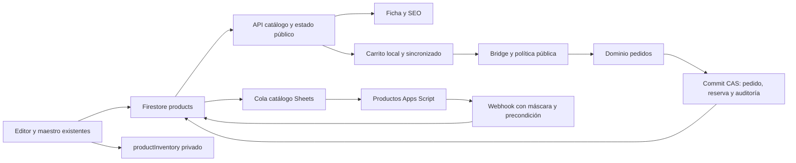

# Arquitectura actual inspeccionada

Fotografía estática de `6ac1fdf2546fa859412399f88eccf207991880de`, 2026-10-23. Los símbolos/campos se contrastaron leyendo el código; no se ejecutaron CRUD autenticados ni se auditó la configuración desplegada.

| Ref | Autoridad / archivo | Responsabilidad verificada |
| --- | --- | --- |
| E1 | [admin.html](../../admin.html), [admin-app.js](../../js/admin/admin-app.js) | Formulario prod-*; serializeProductForm, prodGuardar, edición, duplicado, permisos, suscripción de products/productInventory, auditoría y pushProductsToSheets. |
| E2 | [maestro-productos-core.mjs](../../js/admin/products/maestro-productos-core.mjs), [interfaz](../../js/admin/products/maestro-productos-interfaz.js) | productDuplicateData, productBulkPatch, productCardPatch, productFingerprint, applyProductBulkTransaction. No duplicar estas operaciones. |
| E3 | [gestión de imágenes](../../js/admin/products/gestion-imagenes-admin.js), [fotos por color](../../js/admin/products/fotos-por-color.js), [fotos por variante](../../js/admin/products/fotos-por-variante.js), [resolvedor de fotos](../../js/components/images/foto-variante.mjs) | Carga/galería y asociaciones de atributos; orden de fotos con controles y arrastre en fotos por variante. |
| E4 | [vista previa](../../js/admin/products/vista-previa-producto.js), [controles](../../js/admin/products/controles-editor-producto.js), [adaptación](../../js/admin/products/interfaz-productos-adaptable.js) | Vista previa sin escritura y controles del editor existente. |
| E5 | [inventario-variantes.mjs](../../js/core/store/inventario-variantes.mjs), [modelo de inventario](../../js/core/store/modelo-inventario.mjs) | Identidad de selecciones, grupos, matriz opcional y deltas de reservas. |
| E6 | [contratos comerciales](../contratos-comercio.md), [firestore.rules](../../firestore.rules), [publicación estructural](../../js/core/store/publicacion-producto.mjs) | Integridad de carrito/pedidos/precio/stock y permisos. HasPublicProductFields no sustituye autorización ni visibilidad de colección. |
| E7 | [functions/product.js](../../functions/product.js), [sitemap](../../functions/sitemap-products.xml.js) | Metadata del producto y JSON-LD; no equivale a editor SEO personalizado. |

## Flujos y dependencias

1. Admin lee products; inventario privado procede de productInventory, con suscripción administrativa restringida.
2. prodGuardar valida formulario y completa cargas pendientes antes de serializar URLs/variantMedia. Editar stock usa transacciones y compara el estado original; no reemplazarlo por escritura ciega.
3. Datos comerciales van a products; costo/compras/mínimo/notas a productInventory. **No son una sola escritura atómica universal**: el guardado privado aparece separado. Cualquier garantía futura de atomicidad requiere diseño y prueba específicos.
4. El flujo solicita espejo a Sheets y registra auditoría; fuente y limitaciones: [sincronización canónica](../sincronizacion-productos-canonica.md). No asumir que versiones Apps Script desplegadas coinciden con Git.
5. Catálogo/ficha/carrito usan selección e imágenes compartidas. Checkout vuelve a validar y reserva en servidor, según contrato comercial. Modificar el editor no habilita saltar estas validaciones.

## Límite de la inspección

La matriz de alcance distingue soporte visible, parcial y no acreditado. No se certifican precio por variante completo, estados editoriales completos, editor SEO, plantillas ni estadísticas por producto. Tampoco se declara su ausencia global basándose sólo en búsquedas. Las fases autorizadas después deberán inventariar cada consumidor antes de implementar.

Coordinación: al iniciar estaba abierto #1213, tema global, rama ajena. #1211 ya no aparecía abierto. No se modifican ramas ajenas ni se reaplican correcciones históricas. Comprobar de nuevo al retomar.

## Ampliación fase1 — mapa real de consumidores

Inspección de las fuentes funcionales de main6ac1fdf2546fa859412399f88eccf207991880de; rama documental al inicio f5a905dc1. Todas las diez rutas destacadas por la titular existen y se leyeron. No se usa como autoridad una ruta supuesta inexistente.

| Área | Entradas y dependencias comprobadas | Contrato / riesgo |
| --- | --- | --- |
| Editor y listado | admin.html → admin-app.js; shopify-commerce-admin.js consume maestro-productos-core/interfaz; controles-editor-producto, interfaz-productos-adaptable y vista-previa-producto | Reutilizar el formulario/guardado; la tarjeta no constituye otro motor de precios. |
| Guardado | admin-app.js:6138 prodGuardar; transacción products con fingerprint; productInventory superadmin con merge separado; pushProductsToSheets; logAudit | Reintento de alta retiene ID, pero no hay atomicidad conjunta de todas las etapas H5. |
| Fotos | fotos-por-color.js/fotos-por-variante.js; componentes de imágenes, biblioteca y widget de carga; foto-variante.mjs compartido | Corrección del inventario E3 inicial: gestion-imagenes-admin.js administra navegación de admin-images, no el uploader del editor. No extenderlo para crear otro editor. |
| Datos públicos E8 | functions/api/public-catalog.js con allowlist explícita → core/store/estado-productos.js/cache/tiempo-real-producto → politica-visibilidad-catalogo | variants normalizados a grupos; variantMedia conserva filas; futuros campos requieren proyección pública deliberada. Nunca publicar productInventory. |
| Ficha | functions/product.js, products/[handle].js, sitemap-products.xml.js; components/images/galeria-producto.js; pages/product; js/tienda.js | Metadata y precio base generados; selección de foto compartida. Actualizar enlaces/metadata sin duplicar URLs. |
| Carrito local/sincronizado | sincronizacion-carrito.js; politica-persistencia-carrito.js; politica-visibilidad-catalogo.reconcileCatalogCart | tt_cart; schemaVersion2; users/{uid}/cart/{lineId}; cola serial, guest merge, TTL30min para invitado, reconciliación sólo con catálogo completo. H4: hash incluye cadena ordenada. |
| Checkout | js/orders/pedido-checkout-seguro.js → functions/api/apps-script-bridge.js → politica-checkout-publico.js → order-admin-domain.js | El nombre histórico del bridge no implica que la creación actual ocurra en Apps Script; normalización del borrador y cotización en Cloudflare. |
| Pedidos | functions/api/admin-order-mutation.js y sheets-admin-webhook.js → order-admin-domain.js; core/store/modelo-inventario e inventario-variantes; orders/ciclo-pedido.mjs | Guardias de roles en endpoints, creación atómica con CAS/updateTime, reserva pública inicial, transición/manual compatible, cancelación y reapertura idempotentes; variantInventoryItems conserva huella de reserva. |
| Sheets | sheets-products-webhook.js (changedFields/updateMask/CAS), sheets-product-sync.js; apps-script/ProductosUnificados.gs y AdminParity.gs | Firestore autoridad; columnas actuales no editan combinaciones. Merge conserva campos desconocidos de primer nivel; reemplazar variants sí puede perder metadatos anidados si se diseñan allí. |
| Importaciones | importacion-admin.js → aplicar-importacion-admin.js → shopify-import-core.mjs/identity; admin-import-job.js para control del job, admin-import-media.js para medios | No confundir registro de job con escritura comercial. buildCatalogProductFromImport proyecta grupos/matriz finita; precio variante no se convierte en autoridad H1. Guardar/actualizar sólo por pipeline/identidad canónicos. |
| Roles e historial | core/auth/roles.js y permisos-roles.js; firestore.rules:1295–1350; logAudit en admin-app; auditoría de pedidos en commit del dominio | productInventory sólo superadmin; products escritura por permisos; rules públicas no son validador automático de esquema v2 para todos los roles privilegiados. |
| SEO/estadísticas/plantillas | functions/product.js; admin-app.js:1590–1633 ranking; participacion-clientes/admin y productReviewStats/productEngagementStats | Existen SEO automático, ranking y contadores de participación. No existe selector de plantilla del producto en formulario/guardado inspeccionados. Estadísticas completas por ID requieren diseño, no otro sistema de analítica. |
| CI | package.json; config/ci-stages.json; scripts/ci-stage.mjs, ci-result.mjs y ci-preflight.mjs; .github/workflows/auditar-tintin.yml | A/preflight; B/comercio+reglas; C/admin; D/calidad+browser; agregador exige todas. No cambiar gates en fase1. |

Lectura estática y simulaciones locales no acreditan paridad de reglas/Apps Script desplegados ni una compra autenticada real. Historial y reproducciones: [auditoría](09-AUDITORIA-FASE-1.md).
