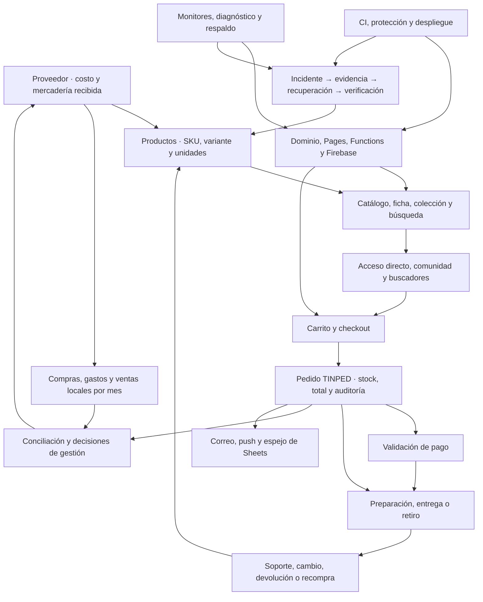

# Mapa maestro de operación y decisiones de Tintín

Entrada para operar la tienda, determinar dónde corregir un fallo y documentar una decisión que atraviesa varios módulos. Para el uso diario, abrir el [manual de Tintín](manual-tintin.md).

## De la mercadería a la recompra

La flecha de posventa a inventario representa una verificación de existencias cuando corresponde. La reserva, liberación y conciliación siguen el [contrato de comercio](contratos-comercio.md).

## Autoridades y señales de operación

| Ámbito | Dónde se opera y dónde se verifica | Evidencia para decidir |
| --- | --- | --- |
| Proveedores, costos y existencias | Recepción física, **Productos** y **Ventas locales**. Firestore conserva catálogo e inventario por variante. | SKU y unidades recibidas, vendidas, disponibles y reservadas. Gastos y compras registrados por fecha y mes. |
| Venta web | Checkout, proveedor de pago y **Pedidos**. El dominio del servidor valida productos, stock y totales y confirma la operación atómica. | TINPED, revisión, estado de pago, estado de entrega y movimiento de stock. |
| Venta local e historial | **Ventas locales** y espejo mensual autorizado. Conserva el identificador y el importe registrados. | Mes, movimiento, revisión y conciliación con el soporte comercial. |
| Entregas, atención y devoluciones | **Pedidos**, canal de atención y políticas públicas de envío y devoluciones. | Pedido, comprobante, coordinación logística, resolución y existencias verificadas cuando aplique. |
| Crecimiento y rentabilidad | Catálogo, contenido, canales comerciales y reportes propios. | Conversiones por canal cuando haya atribución, ventas efectivamente pagadas, costos y devoluciones del mismo período. |
| Datos e identidades | Firebase Auth, Firestore y **Usuarios y permisos**. Sheets opera campos y acciones expresamente autorizados. | Identidad canónica, rol, revisión y rastro de auditoría. Clientes históricos conservan su vínculo explícito. |
| Presentación y accesibilidad | Páginas públicas, temas compartidos y editor autorizado. | Compra navegable con teclado y tacto, controles visibles, reducción de movimiento, geometría y carga sobre los anchos canónicos. |
| Descubrimiento e indexación | Dominio público, URLs canónicas, metadatos, robots y sitemaps. Search Console muestra el estado observado por Google. | Ejemplos publicados y rastreables, metadatos de ficha y estado de URL consultado en Search Console. |
| Disponibilidad y continuidad | GitHub Actions, Cloudflare Pages, **Flujo de conexiones**, proveedores y respaldos. | Último despliegue, salud por superficie, ejecución y artefacto, alcance, restauración comprobada. |

En una conciliación, usar el [contrato de autoridad](autoridades-sincronizacion.md) para identificar el dueño de cada campo. Si dos superficies muestran resultados distintos, comparar el último cambio confirmado y su revisión antes de editar. El mapa de [arquitectura](arquitectura-operativa-canonica.md) ubica las conexiones y [operación continua](operacion-continua.md) reúne los controles.

## Tres recorridos de verificación

### Producto publicado

1. Confirmar existencia y variante, guardar la ficha y verificar la visibilidad.
2. Abrir la URL pública, buscar el artículo en catálogo y comprobarlo desde su colección si pertenece a una.
3. Para revisar SEO, comprobar URL canónica, metadatos de servidor y sitemap de productos. Usar Search Console para una observación propia del buscador.
4. Si alguien informa diferencias, comparar Firestore, ficha, caché y resultado del espejo. Registrar la fuente y la hora de cada muestra.

### Pedido con pago, entrega o devolución pendiente

1. Buscar el pedido por TINPED. Comprobar los estados de pago y entrega por separado.
2. Contrastar importe, referencia y estado con el proveedor o el comprobante. Si hubo reintentos, conciliar el pedido existente antes de registrar uno nuevo.
3. Continuar el flujo aplicable desde **Pedidos**. Verificar evidencia de entrega, movimiento de stock y asiento comercial según el caso.
4. Si falla correo o Sheets, comprobar primero si se confirmó el pedido. Revisar la cola o el espejo correspondiente mediante el [runbook de conciliación](runbook-conciliacion-checkout.md).

### Incidente de producción o GitHub

1. Abrir el aviso o [GitHub Actions](https://github.com/tintinaccs/tintin-web/actions). Identificar commit, ejecución, intento, paso fallido y superficie.
2. Si afecta clientes, comprobar una operación de lectura equivalente desde el dominio público y revisar **Flujo de conexiones**. Distinguir fallo presente, recuperación observada y entorno pendiente.
3. Dejar que los reintentos acotados o la reconciliación atiendan fallos transitorios. Ante un conflicto de datos, preservar ambas revisiones. Ante un fallo persistente, seguir el contrato o runbook del dominio.
4. Volver a medir la superficie afectada, verificar el resultado en el siguiente ciclo y cerrar con evidencia. Para reparación de código, seguir el [flujo protegido](agent/AUTONOMOUS_REPAIR.md).

## Decisiones y continuidad

Una decisión queda trazable si se registra fecha, pregunta concreta, responsable, evidencia y fuente, opción elegida, impacto y forma de verificar o revertir. Registrar decisiones de negocio y permisos junto al contrato correspondiente. Registrar reparaciones técnicas y evidencias actuales en [Estado del agente](agent/CURRENT_STATE.md). Conservar el detalle de clientes y las credenciales en los sistemas autorizados.

| Indicador | Cómo leerlo |
| --- | --- |
| Disponibilidad observada | Pasos sanos sobre pasos medidos, separados por superficie y período. Comparar el monitor con la verificación de clientes cuando exista. |
| Retraso de una integración | Tiempo entre la operación canónica y su confirmación en correo, espejo o proveedor. Distinguir pendientes recuperables y agotados. |
| Inventario | Unidades vendibles por variante, reservas vigentes y diferencia respecto al conteo físico. |
| Flujo de pedidos | Pedidos registrados, pagados, entregados, cancelados y devueltos, cada uno con su definición y fecha. |
| Margen | Ingresos efectivamente conciliados, menos mercadería, comisiones, envíos absorbidos y devoluciones del período que corresponda. |
| Indexación | URLs canónicas publicadas, URLs rastreadas e indexadas según Search Console, y errores observados por tipo. |
| Recuperación | Fecha, alcance y validación del último ensayo de restauración; tiempo entre detección y recuperación confirmada en incidentes reales. |
